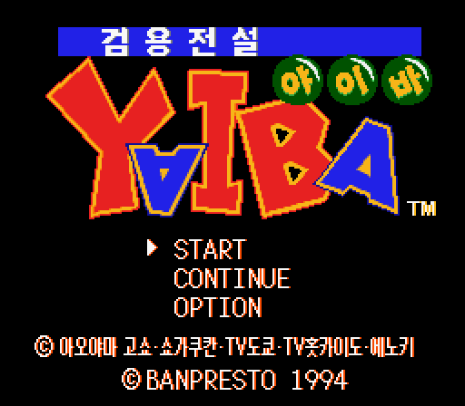

# 〈검용전설 야이바〉 한글패치

SFC용 〈剣勇伝説YAIBA〉를 한국어로 플레이하기 위한 비공식 팬 한글패치입니다.

[한글패치 다운로드](https://github.com/voltage-gated/yaiba-sfc/releases/latest)

## 프로젝트 개요

### 한글 표시

타이틀 로고, 메뉴, 대사, 아이템, 지명, 상태 화면, 간판, 스태프롤까지 게임 속 글자를 모두 한국어로 바꿨습니다.

### 타이틀 음악

타이틀 화면 음악을 원작 애니메이션 오프닝곡으로 바꿨습니다.

### 치트 메뉴

게임 중 START를 눌러 나오는 메뉴 화면에서 SELECT를 누르면 치트 메뉴가 열립니다.

### 구슬 복원

용신구슬로 하늘을 날 수 있습니다. 게임 내부 자료로만 남아 있던 거대구슬, 어둠구슬, 땅구슬도 살려 실제로 쓸 수 있게 했습니다.

### 편의 기능

- B 버튼 취소를 늘리고 새 조작 타입 E를 더했습니다.
- 드나들기 어렵던 문과 마을 출구를 쉽게 지나가게 했습니다.
- HUD에 HP·MP 바를, 상태·장비 화면에 초상화를 넣었습니다.
- 아군 대미지 표시와 소모품 묶음 표시를 더했습니다.
- 번개베기를 더 쉬운 커맨드로도 발동되게 수정했습니다.
- 비 오는 날을 줄였습니다.

## 대응 ROM

| 항목 | 내용 |
| --- | --- |
| 파일명 | `Kenyuu Densetsu Yaiba (Japan).sfc` |
| 기종 | Super Famicom (SFC) |
| 크기 | 1,572,864 bytes (복사기 헤더 없음) |
| CRC32 | `91FE7070` |
| SHA-1 | `a3c391d3ae370467b8af9fd91a430e8b6098f9da` |
| SHA-256 | `8511950f35be6bc2afd4a8dc2cf7fcbb73a98f42391cb07b7d062a91eff4ba51` |

원본 ROM과 완성 ROM은 포함하지 않습니다.

## 적용 방법

1. 위 해시와 일치하는, 패치하지 않은 일본판 원본 ROM을 준비합니다.
2. ROM 확장을 지원하는 IPS 적용 도구(Floating IPS, Rom Patcher JS 등)로 원본 ROM의 복사본에 패치를 적용합니다.
3. 적용 후 ROM이 4,194,304 bytes이고 CRC32가 `110D07DD`인지 확인합니다.

한글 타이틀이 뜬다고 해서 적용에 성공한 것은 아닙니다. 이전 버전 위에 적용해도 한글 타이틀은 뜨므로, 반드시 CRC32나 SHA-256으로 확인하세요.
512바이트 헤더가 붙은 ROM(1,573,376 bytes)에 그대로 적용하면 깨진 ROM이 나옵니다. 헤더를 먼저 제거하거나 Rom Patcher JS의 헤더 제거 옵션을 사용하세요.
에뮬레이터의 자동 패치 적용을 쓸 때는 완성 ROM을 IPS와 다른 폴더에 두세요.

## 배포 및 권리

이 프로젝트는 공식 허가나 보증을 받지 않은 비영리 팬 제작물입니다.

게임과 게임 내 원본 저작물에 대한 권리는 원작자 및 각 권리자에게 있으며, 이 프로젝트는 해당 권리를 주장하지 않습니다. 원본 ROM과 패치된 ROM은 공유하지 마세요.

패치 파일은 원출처를 명시하는 조건으로 수정 및 재배포할 수 있습니다.

## 문제 제보

사용한 버전, 완성 ROM의 해시값, 에뮬레이터와 설정(코어), 재현 과정과 화면을 함께 제보해 주세요.

[Issue 작성](https://github.com/voltage-gated/yaiba-sfc/issues)
